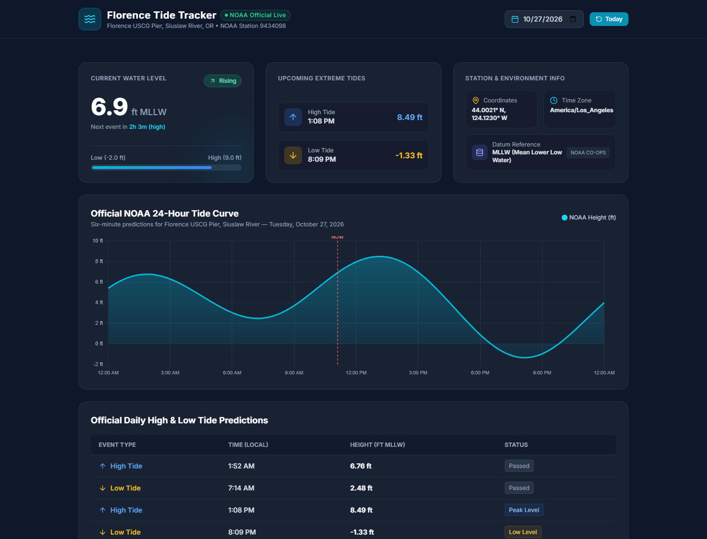
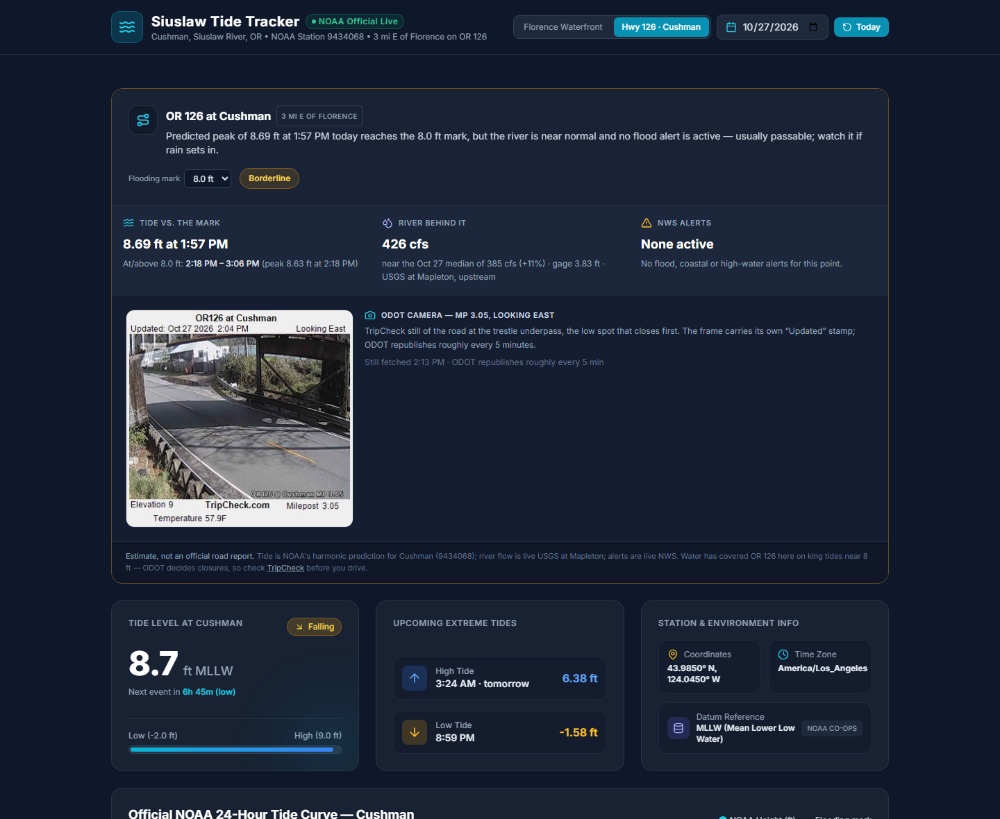

# Siuslaw Tide Tracker

A single-file tide dashboard for the Siuslaw River, Oregon — **Florence** (NOAA station 9434098) and **Cushman** (9434068) — built on the official [NOAA CO-OPS Data API](https://api.tidesandcurrents.noaa.gov/api/prod/), with a tide-driven high-water watch for **OR 126 at Cushman**.

**Live:** https://nwfella.github.io/florence-tide-tables/



## What it does

**Florence Waterfront view**

- **Current water level**, interpolated from six-minute NOAA predictions (not snapped to the nearest sample), with a rising/falling badge and a datum meter on a −2 → +9 ft scale.
- **Next high / next low** — the next events *still ahead of you*, with a live countdown. After the last tide of the day it pulls tomorrow's first events instead of showing a time that already passed.
- **24-hour tide curve** from six-minute predictions, with a dashed `NOW` marker.
- **Full daily extremes table** with passed / upcoming status.
- **Any date**, past or up to a year ahead.

**Hwy 126 · Cushman view** — the same dashboard for the station at Cushman, plus an OR 126 road-water panel:



- **Verdict pill** — *Tide below the mark* / *Borderline* / *Water on the road likely*.
- **Tide vs. the mark** — the day's predicted peak and the exact window the tide sits at or above the mark, e.g. `12:48 PM – 3:06 PM (peak 8.69 ft)`.
- **River behind it** — live USGS discharge and gage height at Mapleton (upstream), compared with that calendar day's **50th-percentile flow** over the gauge's record, so "408 cfs" becomes "near the Oct 27 median of 385 cfs".
- **NWS alerts** — active flood / coastal / high-water alerts for the point, straight from `api.weather.gov`.
- **ODOT camera** — the TripCheck still from **OR 126 at Cushman, MP 3.05, looking east** at the trestle underpass. It's the one pane that shows water on the road directly; the frame carries its own "Updated" stamp, and the page re-fetches it every minute while the tab is visible.
- A dashed **flooding-mark line** on the chart, and a **Flooding mark** selector (7.5 / 8.0 / 8.5 / 9.0 ft) that persists in `localStorage`, so locals can tune it to what they actually see.

Both views share one date picker and one render pipeline, and a render-token guard drops any late response from a previous station or date, so the two views can never disagree about the same state.

## Can NOAA tide data alone answer "is Cushman flooded?"

Not reliably — and the app says so. Tide is the biggest factor (the road floods *at high tide* and drains as it falls), but the low spot under the rail trestle on OR 126 also depends on how much fresh water the Siuslaw is pushing down, and on rain. So the verdict is a documented heuristic over three live feeds, not a single tide number:

| | |
| --- | --- |
| Tide | NOAA harmonic predictions, station **9434068** (Cushman, Siuslaw River), MLLW feet |
| River | USGS **14307620** (Siuslaw River near Mapleton) — instantaneous discharge + gage height, plus that date's p50 median from the USGS daily-statistics service |
| Alerts | NWS active alerts for `43.985,-124.045` (Coastal Flood / Flood / High Surf etc.) |

Decision rule (also spelled out in the panel footer):

```
elevated river = discharge >= 1.5 x that day's median discharge
overflow       = peak >= mark  AND (elevated river OR any flood/coastal alert)
watch          = peak >= mark  (river normal, no alert)
               | peak >= mark - 0.5  AND (elevated river OR a warning-level alert)
clear          = otherwise
```

**Where the 8.0 ft mark comes from.** It is an empirical anchor from reported closures, not an official flood stage:

- Coast Radio (KCFM), 5 Jan 2022: *"An 8 foot high tide hit at 1:22 yesterday causing the road under the train tressel to flood"* — and 7.6 ft was flagged as likely to flood again.
- KVAL / ODOT, 4 Jan 2022: OR 126W closed at Cushman, 3 mi east of Florence; ODOT described it as *"the highest seen in a few years, a combination of 3.5 inches of water and a king tide."*
- KPIC: king tides pushing water onto OR 126 at Cushman, with midday highs *"approach[ing] 8 feet"*, under an NWS Coastal Flooding Advisory.

So ~8 ft is where water has reached the road, and wet weather moves the practical limit down. The 1.5×-median river threshold and the 0.5 ft watch band are chosen heuristics — adjustable in the UI, and stated as estimates rather than dressed up as a calibrated model.

**Hard limitations**

- Station 9434068 has been **predictions-only since its sensor was removed in 2018** — there is no observed water level to compare against, so the app cannot confirm water is on the road.
- Tide gates, culverts and local drainage aren't modelled; the Mapleton gauge is upstream and only a proxy for how hard the river is pushing back.
- **ODOT decides closures.** The panel links [TripCheck](https://tripcheck.com/) for the actual road status.

### The camera

ODOT's roadside stills are **not a public API**. The image is served straight from `tripcheck.com/RoadCams/cams/<filename>`, where the filename embeds ODOT's published-image id — this one is `ORE126 at Cushman_pid2651.JPG`, resolved from [the TripCheck camera inventory](https://tripcheck.com/Scripts/map/data/cctvinventory.js) (`cameraId 548`, `route OR126`, `title "OR126 at Cushman"`).

- **Cadence:** measured by polling `Last-Modified` — `20:58:52Z` then `21:04:33Z`, so ODOT republishes roughly every **5½ minutes**. The page re-fetches every 60 s (and on tab focus) with a `?t=` cache-buster, so the still is never more than a minute behind ODOT.
- **No CORS on the inventory file**, so the page can't re-resolve the filename by itself. If ODOT re-publishes the camera the image 404s, the page hides it and links out to TripCheck instead of showing a broken frame. To fix, re-read the inventory and update `CAM.cushman.url`.
- There is a second camera in the inventory, `Siuslaw River Florence (USCG)` (`pid4901`) — it currently serves a **"This image is currently unavailable"** placeholder last updated 17 Oct, so the Florence view deliberately has no camera pane. Check `Last-Modified` before adding it.

### Refresh behaviour

The page keeps itself current, entirely in the visitor's browser — no server, no cron, no build, no API key, no LLM. That also means it costs nothing to run.

| What | When | Requests per refresh |
| --- | --- | --- |
| Tide / river / alerts | every **10 min** while the tab is visible, plus immediately on tab focus if the last render is >60 s old | **2** NOAA + **1** USGS `nwis/iv` + **1** NWS = 4 |
| Camera still | every **60 s** while visible, plus on tab focus | 1 image (~29 KB) |
| Nothing at all | while the tab is hidden | 0 — a phone in a pocket doesn't poll |

Two things are memoised for the session because they cannot change between polls: NOAA predictions for **tomorrow** (fetched only when today's high or low has already passed) and the USGS **p50 median**, which is a period-of-record statistic. Failures are never cached, so a transient outage retries on the next tick. The header carries a `· updated 3:14 PM` stamp so a stale tab is visibly stale rather than silently wrong.

## Data notes

| | Florence | Cushman |
| --- | --- | --- |
| NOAA station | 9434098 — Florence USCG Pier | 9434068 — Cushman, Siuslaw River |
| Coordinates | 44.0021° N, 124.1230° W | 43.9850° N, 124.0450° W |
| Product | `predictions` (harmonic, **not** observations) | same |
| Datum | MLLW, feet | MLLW, feet |
| Time zone | `lst_ldt` — station local time, DST-aware | same |
| Interval | `hilo` for extremes, default six-minute for the curve | same |

All three data sources are keyless and CORS-open (`Access-Control-Allow-Origin: *`), so everything runs in the browser with no proxy and no build step.

There is an offline fallback — a small mixed-harmonic approximation tuned to the Siuslaw range — that only appears when the NOAA request fails. It is labelled *Offline Estimate* in the UI and is not NOAA data. The road verdict never runs on the fallback curve silently: the river and alert cards keep their own live / unavailable states.

## Build

No framework, no bundler, one `index.html`:

```bash
git clone https://github.com/nwfella/florence-tide-tables.git
cd florence-tide-tables
python -m http.server 8000    # then open http://localhost:8000/
```

Serve it over **http(s)**, not `file://`. USGS answers a `file://` page — whose `Origin` header is `null` — with **HTTP 403**, so the river card reads "Unavailable" while everything else looks fine. Any real origin (localhost counts) works.

Runtime dependencies are three public CDNs: Tailwind (Play CDN), Chart.js 4, and Lucide icons; fonts come from Google Fonts.

### Gotchas worth recording

1. **The API rejects `date=exact`.** An earlier revision passed `date=exact&begin_date=YYYYMMDD`, which returns **HTTP 400 `Wrong Date: The supported date values are: latest, recent, or today`** — every request failed and the page silently fell back to the synthetic curve while still claiming "NOAA Live". The correct form is `begin_date=YYYYMMDD&range=24` (or an explicit `end_date`).
2. **USGS daily statistics are RDB-only.** `nwis/stat` returns `text/plain` even when asked for JSON, so the p50 lookup parses tab-separated text; `nwis/iv` does have a JSON format.
3. **Six-minute samples give off-hour labels.** Chart ticks are filtered to clean 3-hour marks, and the grid-line colour is scriptable so only those ticks draw a rule — otherwise 240 samples hatch the plot.
4. **A camera still needs a cache-buster and an existence check.** ODOT serves `Last-Modified` but no `Cache-Control`, so `` will happily re-display a still from an hour ago; append `?t=Date.now()` on each refresh. And the URL is not stable — the published-image id in the filename changes when ODOT re-publishes a camera, so wire an `onerror` fallback instead of trusting a hardcoded path forever.

## License

MIT — see [LICENSE](LICENSE). Tide predictions are NOAA public-domain data; USGS and NWS data are US-government public domain.
